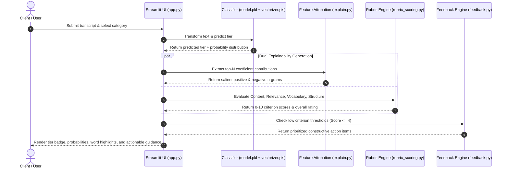
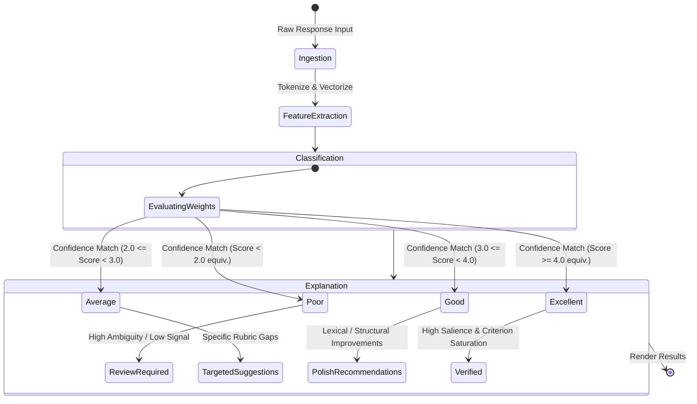

<div align="center">

# 🎯 RIVET
### Rubric-Based Interview Verdict, Evidence, and Transcript
**Automated interview response evaluation with rubric criteria scoring, transparent confidence metrics, and interpretable feature attribution.**

[](https://www.python.org/)
[](https://streamlit.io/)
[](https://scikit-learn.org/)
[](LICENSE)

</div>

---

## Executive Overview

**RIVET** (Rubric-based Interview Verdict, Evidence, and Transcript) is a dual-engine natural language processing framework built to evaluate candidate interview transcripts across standardized quality tiers: **Poor**, **Average**, **Good**, and **Excellent**.

Traditional automated assessment systems operate as opaque "black boxes" that output arbitrary scores without justification. RIVET solves this explainability gap by pairing an empirical statistical machine learning classifier with a transparent, rule-driven rubric heuristic engine. Every verdict is paired with:
1. **Probabilistic Confidence Scores** with automated human-in-the-loop guardrails for ambiguous inputs.
2. **Intrinsic Feature Attributions** decomposing which words or phrases swayed the model's decision.
3. **Four-Dimension Rubric Scoring** (Content Quality, Question Relevance, Vocabulary & Register, and Structural Coherence) on a granular 0–10 scale.
4. **Actionable Constructive Recommendations** providing candidates with targeted paths to improve their interview performance.

---

## Architecture & System Workflows

### 1. End-to-End System Architecture

```mermaid
flowchart TB
    subgraph DataOps["Data Engineering Pipeline"]
        D1["LLM Batch Generation\n(Prompts + Rubric Constraints)"] --> D2["Batch Ingestion Engine\n(merge_datasets.py)"]
        D2 --> D3["Dataset Integrity & Validation\n(validate_dataset.py)"]
        D3 --> D4[("Consolidated Datasets\ndata/raw/*")]
    end

    subgraph MLOps["Model Training & Evaluation"]
        D4 --> M1["Stratified Preprocessing\n(preprocess.py)"]
        M1 --> M2["TF-IDF Vectorization\n(N-gram Range 1-2, 5000 Features)"]
        M2 --> M3["Logistic Regression Classifier\n(train_baseline.py)"]
        M3 --> M4[("Model Artifacts\nmodels/baseline/*.pkl")]
        M3 --> M5["Extended Evaluation Suite\n(evaluate_extended.py)"]
        M5 --> M6[("Evaluation Artifacts\noutputs/*.csv, *.png")]
    end

    subgraph Serving["Runtime Inference & Scoring"]
        User(["Candidate / Recruiter Input"]--> S1["Streamlit Application\n(app.py)"]
        S1 --> S2{"Category Router"}
        S2 -->|introduction| S3["Inference Engine"]
        S2 -->|why-to-hire| S3
        M4 -.-> S3
        S3 --> E1["Intrinsic Model Attribution\n(explain.py)"]
        S3 --> E2["Heuristic Rubric Evaluator\n(rubric_scoring.py)"]
        E2 --> E3["Targeted Feedback Engine\n(feedback.py)"]
        E1 --> S4["Interactive Dashboard Output"]
        E2 --> S4
        E3 --> S4
    end
```

### 2. Runtime Inference & Explainability Sequence



### 3. State & Quality Tier Transitions



---

## Core Technical Methodology

RIVET operates via three decoupled layers: **Statistical ML Classification**, **Deterministic Rubric Scoring**, and **Explainability / Feedback Generation**.

### 1. Statistical Classification Engine
- **Representation**: Sub-linear Term Frequency-Inverse Document Frequency (TF-IDFextraction over unigrams and bigrams (`ngram_range=(1, 2)`), limited to the top 5,000 informative lexical features with English stop-word filtering.
- **Classifier**: Multi-class Logistic Regression with $L_2$ regularization (`solver="lbfgs"`, `max_iter=1000`, `random_state=42`).
- **Feature Attribution**: Decomposes prediction logits by computing the element-wise dot product of the input TF-IDF vector against the logistic regression weight vector for the predicted class:
  $$\text{Contribution}(w) = x_w \cdot \beta_{c, w}$$
  Positive weights indicate words that actively drove the classification, while negative weights indicate missing or detracting signals.

### 2. Heuristic Rubric Scoring Engine
Complementing the machine learning model, RIVET computes four objective, rule-based dimension scores scaled from $0$ to $10$:
- **Content Quality (35% weight)**: Scans for evidence across five professional categories: Education, Technical/Soft Skills, Projects & Applications, Achievements & Honors, and Career Goals.
- **Question Relevance (25% weight)**: Measures semantic alignment against question-specific intent keywords, penalizing off-topic tangents, brevity, or generic filler.
- **Vocabulary & Register (25% weight)**: Audits action-verb density, professional lexicon usage, lexical diversity (Type-Token Ratio), and flags low-effort filler phrases.
- **Structural Coherence (15% weight)**: Inspects structural sequencing markers (e.g., STAR method connectors, introductory statements, chronological transitions, and concluding wraps).

The final composite rubric score is computed via:
$$\text{Final Score} = 0.35 \times \text{Content} + 0.25 \times \text{Relevance} + 0.25 \times \text{Vocabulary} + 0.15 \times \text{Structure}$$

### 3. Human-in-the-Loop Safeguards
If the predicted class probability is below $40\%$ ($\text{confidence} < 0.40$), the response is marked as `needs_review = True`. In the UI, this triggers a **soft amber warning card** alerting evaluators that the input transcript is ambiguous, overly brief, or borderline between tiers.

---

## Supported Question Types

| Identifier | Question Prompt | Target Competencies |
| :--- | :--- | :--- |
| `introduction` | *"Tell me about yourself"* | Background synthesis, academic credentials, key technical proficiencies, project experience, career ambitions. |
| `why-to-hire` | *"Why should we hire you?"* | Value proposition alignment, role suitability, differentiated problem-solving skills, and quantifiable achievements. |

---

## Design System & UI Architecture

The frontend is styled according to the **RIVET Light Theme Design System**, inspired by the clean, typography-focused SPARK aesthetic:

### Design Tokens

| Token | Value | Applied To |
| :--- | :--- | :--- |
| `primary` / `primary-foreground` | `#335b49` / `#ffffff` | Primary action buttons, logo mark, key metrics, active accents. |
| `secondary` / `secondary-foreground` | `#eaeaeb` / `#303036` | Secondary controls, widget borders, subtle badges. |
| `accent` / `accent-foreground` | `#e5ebe8` / `#2e5242` | Active tab background, selected states. |
| `background` / `foreground` | `#f7f7f8` / `#1d1d20` | Canvas background and primary typography. |
| `card` / `card-foreground` | `#ffffff` / `#1d1d20` | Rounded cards, containers, input backgrounds. |
| `muted` / `muted-foreground` | `#efeff0` / `#68686e` | Table headers, secondary labels, metadata captions. |
| `border` / `input` | `#d5d5d8` / `#cfcfd3` | 1px container borders and input outlines. |
| `ring` | `#335b49` | Focus outlines on text areas and selects. |
| `chart-1` (Green) | `#40725c` | **Excellent** quality tier badge, confusion matrix gradient. |
| `chart-2` (Blue| `#4375b1` | **Good** quality tier badge, secondary model comparison bar. |
| `chart-3` (Amber| `#ad722e` | **Average** quality tier badge, human review warning border. |
| `chart-4` (Purple) | `#7f5ca3` | Tertiary categorical comparisons. |
| `chart-5` (Rose) | `#af4b5c` | **Poor** quality tier badge. |

### Typography & Spacing
- **Sans-Serif (`Raleway`)**: Applied across all headings, labels, button text, and prose. Fallbacks: `system-ui, -apple-system, sans-serif`.
- **Monospace (`Roboto Mono`)**: Applied to all numbers, percentages, confidence scores, and code blocks.
- **Offline Assets**: All fonts are bundled locally in `static/fonts/` (`.woff2` and variable `.ttf`) and registered directly with Matplotlib and Streamlit, guaranteeing complete functionality without an internet connection.
- **Geometry & Rhythm**: Base border radius of `2rem` for cards, primary buttons, and tabs; `1rem` for inputs and textareas; full pill (`9999px`) for badges. Spacing follows multiples of `0.23rem`.
- **Resilient Fallback**: If `pyarrow` is omitted in the host environment, tables automatically render via styled semantic HTML tables (`df.to_html`), avoiding unexpected runtime halts.

---

## Repository Structure

```text
RIVET/
├── .streamlit/
│   └── config.toml                 # Streamlit light theme tokens & static server config
├── app.py                          # Streamlit application entry point & UI orchestration
├── requirements.txt                # Python package dependencies
├── README.md                       # Comprehensive system documentation & runbook
├── MULTI_DATASET_USAGE.md          # Multi-category ingestion guide
├── .gitignore                      # Git exclusion rules (venv, models, outputs)
│
├── data/
│   └── raw/
│       ├── introduction/           # Batches & consolidated interview_responses.csv
│       └── why-to-hire/            # Batches & consolidated interview_responses.csv
│
├── docs/
│   ├── scoring_rubric.md           # 4-dimension scoring rubric & weighting definitions
│   ├── dataset_schema.md           # Formal CSV data specifications
│   └── dataset_generation_guidelines.md
│
├── prompts/
│   ├── introduction_dataset_generation.md
│   └── whytohire_dataset_generation.md
│
├── src/
│   ├── dataset/
│   │   ├── dataset_config.py       # Centralized category registry & directory resolver
│   │   ├── dataset_utils.py        # Dataset helper routines
│   │   ├── merge_datasets.py       # Batch deduplication and consolidation pipeline
│   │   └── validate_dataset.py     # Schema validation, label parity, and range checks
│   │
│   ├── training/
│   │   ├── preprocess.py           # Stratified train/test data splitting
│   │   ├── train_baseline.py       # Production training (TF-IDF + Logistic Regression)
│   │   ├── evaluate_baseline.py    # Baseline classification evaluation
│   │   └── evaluate_extended.py    # 5-fold CV, per-category slices, and cross-domain test
│   │
│   ├── explain/
│   │   ├── explain.py              # Intrinsic coefficient-level feature attribution
│   │   ├── rubric_scoring.py       # Heuristic 4-dimension evaluation engine (0-10 scale)
│   │   └── feedback.py             # Rule-driven constructive feedback generator
│   │
│   └── ui/
│       ├── __init__.py             # UI module exports
│       ├── theme.py                # Central design token repository (colors, fonts, radii)
│       ├── styles.py               # Injected CSS stylesheet & layout overrides
│       ├── charts.py               # Themed Matplotlib charts & sequential green colormap
│       └── components.py           # Header, hero, stat cards, badges, and alerts
│
├── static/
│   └── fonts/                      # Offline Raleway & Roboto Mono font assets (.woff2, .ttf)
│
├── models/                         # Serialized models (git-ignored)
│   └── baseline/                   # model.pkl, vectorizer.pkl
│
└── outputs/                        # Evaluation metrics & visualizations (git-ignored)
    ├── classification_report.csv   # Precision, recall, and F1 across tiers
    ├── confusion_matrix.png        # RIVET-themed confusion matrix plot
    ├── cross_validation.csv        # 5-fold stratified cross-validation results
    ├── per_type_accuracy.csv       # Slice metrics for introduction vs why-to-hire
    └── model_comparison.csv        # Logistic Regression vs Multinomial Naive Bayes
```

---

## Environment Setup & Installation

### 1. Prerequisites
- Python **3.10** or higher
- Windows PowerShell, macOS Terminal, or Linux Bash

### 2. Virtual Environment Configuration

#### Windows (PowerShell)
```powershell
# 1. Clone repository
git clone https://github.com/Krissh360/RIVET.git
cd RIVET

# 2. Create virtual environment
python -m venv venv

# 3. Activate virtual environment
Set-ExecutionPolicy -Scope Process -ExecutionPolicy Bypass
.\venv\Scripts\Activate.ps1

# 4. Install dependencies
python -m pip install --upgrade pip
python -m pip install -r requirements.txt
```

#### macOS / Linux
```bash
git clone https://github.com/Krissh360/RIVET.git
cd RIVET

python3 -m venv venv
source venv/bin/activate

pip install --upgrade pip
pip install -r requirements.txt
```

---

## Pipeline Execution Runbook

All commands must be executed from the root directory with the virtual environment active.

### Step 1: Data Ingestion and Consolidation
Merges raw CSV batches into master category datasets while validating unique IDs and schema constraints:

```bash
python src/dataset/merge_datasets.py --category introduction
python src/dataset/merge_datasets.py --category why-to-hire
```

### Step 2: Dataset Integrity Validation
Validates score bounds ($1$ to $5$), non-null transcript text, and uniform distribution across tiers:

```bash
python src/dataset/validate_dataset.py --category introduction
python src/dataset/validate_dataset.py --category why-to-hire
```

### Step 3: Model Training
Fits the TF-IDF vectorizer and Logistic Regression classifier across consolidated data:

```bash
python src/training/train_baseline.py
```
*Generated Artifacts:* `models/baseline/model.pkl` and `models/baseline/vectorizer.pkl`.

### Step 4: Comprehensive Model Diagnostics
Executes the extended evaluation suite, computing 5-fold cross-validation, per-type accuracy slices, cross-domain degradation, and visual confusion matrices:

```bash
python src/training/evaluate_extended.py
```
*Generated Artifacts:* Stored in `outputs/` including `confusion_matrix.png`, `cross_validation.csv`, and `classification_report.csv`.

### Step 5: Launch Streamlit Web Application
To bypass Windows Application Control (WDACpolicies on wrapper binaries, invoke Streamlit through the Python interpreter:

```powershell
.\venv\Scripts\python.exe -m streamlit run app.py
```
*(Or on macOS/Linux: `streamlit run app.py` or `python -m streamlit run app.py`)*

The dashboard will open automatically in your browser at `http://localhost:8501`.

---

## Empirical Evaluation & Benchmarks

All metrics reflect evaluations on held-out stratified test splits ($N=500$) drawn across both question types ($2,499$ total samples).

### Classification Performance (Logistic Regression)

| Tier | Precision | Recall | F1-Score | Support |
| :--- | :---: | :---: | :---: | :---: |
| **Poor** | `0.93` | `0.93` | `0.93` | 125 |
| **Average** | `0.88` | `0.85` | `0.87` | 125 |
| **Good** | `0.90` | `0.86` | `0.88` | 125 |
| **Excellent** | `0.91` | `0.99` | `0.95` | 125 |
| **Overall Accuracy** | — | — | **`90.60%`** | 500 |

### 5-Fold Stratified Cross-Validation
- **Mean CV Accuracy**: **`90.64% ± 0.72%`**
- **Fold Breakdown**: Fold 1: `91.40%` | Fold 2: `90.20%` | Fold 3: `89.80%` | Fold 4: `90.20%` | Fold 5: `91.58%`

### Per-Question-Type Slice Accuracy
- **Introduction** (`Tell me about yourself`): **`93.16%`** ($N=307$ test samples)
- **Why-To-Hire** (`Why should we hire you?`): **`86.53%`** ($N=193$ test samples)

### Model Comparison
- **Logistic Regression (TF-IDF)**: **`90.60%`** accuracy
- **Multinomial Naive Bayes (TF-IDF)**: **`78.60%`** accuracy

### Cross-Domain Transfer Analysis
| Train Domain | Test Domain | Test Accuracy | Degradation Cause |
| :--- | :--- | :---: | :--- |
| `introduction` | `why-to-hire` | `57.26%` | Shift in expected vocabulary from personal narrative to value proposition. |
| `why-to-hire` | `introduction` | `60.27%` | Under-representation of academic/educational journey terms. |

*Finding*: The sharp drop when training on one question type and evaluating on another demonstrates that the model learns domain-specific interview competencies rather than shallow lexical shortcuts.

---

## Sample Inference Contract

### Input Transcript
> *"I am a third-year Computer Science student at university. I have strong skills in Python, SQL, and machine learning. I built a web application for student tracking and won a hackathon competition. My long-term goal is to become a Machine Learning Engineer."*

### Output Verdict & Breakdown
```text
Quality Verdict     : Excellent (Pill Badge: #40725c)
Confidence Score    : 88.4%
Human Review        : False

Rubric Dimensions (0-10):
  - Content Quality : 9.5/10 (Discovered: Education, Skills, Projects, Achievements, Goals)
  - Relevance       : 8.5/10 (Direct alignment with introduction prompt)
  - Vocabulary      : 8.0/10 (Active action verbs, low filler density)
  - Structure       : 7.8/10 (Sequential: Background -> Skills -> Project -> Future Goal)
  - Overall Weighted: 8.6/10 (0.35*C + 0.25*R + 0.25*V + 0.15*S)

Top Contributing Features:
  1. "machine learning" (+1.42)
  2. "python"           (+1.18)
  3. "hackathon"        (+0.95)
  4. "student"          (+0.81)
  5. "built"            (+0.74)

Constructive Feedback:
  "Strong, well-rounded introduction. Consider quantifying the impact or user metrics of your tracking project to strengthen your case further."
```

---

## Design Considerations & Roadmap

1. **Synthetic Data Realism**: Initial batches are synthetically curated through rigorous LLM prompting under strict rubric constraints. Periodic calibration against recorded human candidate responses is recommended for live deployment.
2. **Deterministic Explainability**: Rubric sub-scores serve as interpretable behavioral heuristics that students and recruiters can inspect and defend during evaluations.
3. **Model Evolution**: The current TF-IDF + Logistic Regression baseline provides sub-millisecond inference and white-box interpretability. Future versions will explore dense sentence embeddings (e.g., `BGE-large` or `MiniLM`paired with cross-encoders for zero-shot question generalization.
4. **Language Localization**: Current heuristic dictionaries and stop-word lists target standard professional English.

---

<div align="center">
  <sub>Developed for the RIVET Project. Designed with clean engineering and transparent machine learning.</sub>
</div